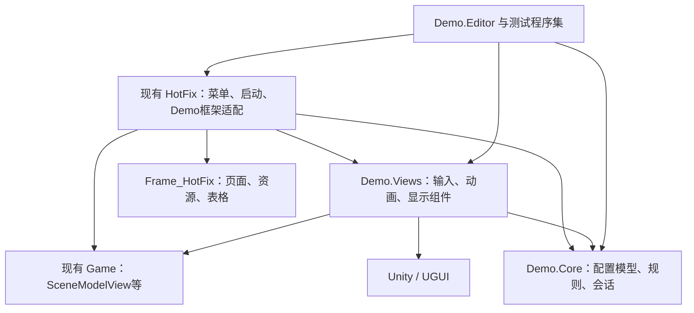
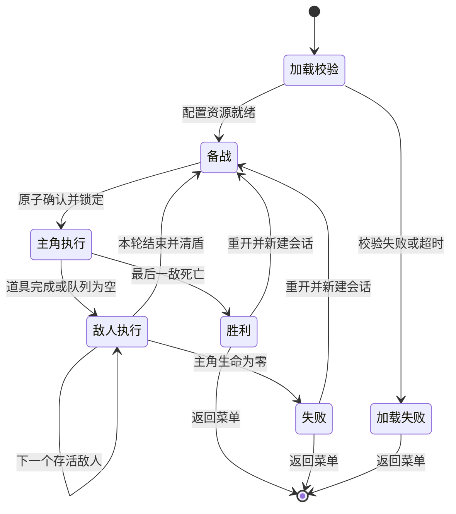

# 单场战斗 Demo 技术设计

## 状态与设计依据

- 状态：用户以“继续，按阶段批量执行”确认技术设计；进入任务拆解阶段，尚未实施业务代码。
- 依据：本目录 `requirements.md`、GDD v0.3.2、术语表和已确认开发提案。
- 核心价值：以配置驱动、可独立测试的规则层，串通整理背包、确认行动、演出结算、敌人行动及重开闭环。
- 标记：已核实表示源码或文件事实；设计决策表示拟实施方案；待实测表示需要在开发阶段验证。

## 步骤

- [x] 检查现有启动、页面、表格、资源与热更加载实现。
- [x] 明确程序集、数据、流程、表现与生命周期设计。
- [x] 对照需求检查设计覆盖。
- [x] 用户确认技术设计。

## 一、已核实的接入约束

1. `GameEntry` 初始化 `Game`，进入 `LaunchScene`，再由 `HybridCLRSystem` 启动 `GameHotFix`；`GameHotFixBase` 先注册和加载表，再注册页面、初始化系统并进入 `MainScene`。
2. 当前 `MainSceneLoading` 只加载 `UIMain`，新游戏按钮尚未绑定业务。
3. `LayoutManager` 支持通过显式预制体名称注册页面；不能依赖带命名空间的类型名自动拼资源路径。
4. `ResourceManager` 的游戏资源路径相对于 `Assets/GameResources`，包含文件后缀，编辑器与包分别使用不同底层加载源。
5. `ExcelManager` 预加载 `Excel` 资源包；`ExcelTable` 从 `Excel/表名.bytes` 加载，按 `ExcelData.mID` 整数行号索引，使用框架二进制读取器及表名相关字节变换。
6. 框架表格默认延迟解析，基类错误主要写日志，不能将“异步加载回调触发”等同于“全部表有效”。
7. `Assets/Resources/Settings/FrameSettings.asset` 热更清单只有 `Frame_HotFix` 和 `HotFix`；本设计不增加热更 DLL。
8. `HeroPreview`、`MonsterPreview` 会控制动画采样，仅能作为参考工具，不参与实际战斗。
9. 资源实际打包、Windows运行、动画命中帧与界面组合仍待实测；本文件不是通过报告。

## 二、目录与程序集

```text
Assets/Demo/
├── Runtime/
│   ├── Demo.HotFix.asmref             # 指向现有HotFix程序集
│   ├── Core/
│   │   ├── Demo.Core.asmdef           # 无Unity依赖
│   │   ├── Configuration/            # 纯数据定义与校验
│   │   ├── Domain/
│   │   │   ├── Inventory/
│   │   │   ├── Items/
│   │   │   └── Battle/
│   │   └── Application/              # 会话、命令、规则推进
│   ├── Views/
│   │   ├── Demo.Views.asmdef          # Unity可挂载组件，不依赖热更
│   │   ├── UI/                       # 拖动输入、显示与坐标转换
│   │   ├── Actors/                   # 动画、移动与头顶跟随
│   │   └── Effects/                  # 临时/正式效果播放
│   ├── Infrastructure/
│   │   ├── Configuration/            # 框架表行、注册和读取
│   │   ├── Resources/                # ResourceRef生命周期
│   │   └── Diagnostics/              # 日志落盘
│   ├── Presentation/                 # LayoutScript与页面协调器
│   └── Integration/                  # 系统注册、入口、场景流程
├── ConfigSource/                     # CSV与字段说明
├── Editor/                           # 导表、资源检查、场景生成、构建
├── Scenes/                           # 非每轮重载的Demo场景
├── Tests/
│   ├── EditMode/
│   └── PlayMode/
└── Documentation/

Assets/GameResources/
├── Excel/Demo*.bytes
├── Demo/                             # 新增战斗资源、资源清单与表现绑定
└── UI/UIPrefab/Demo/                  # 必要的页面变体/组合资源
```

程序集依赖如下。箭头表示调用方依赖被调用方：



- `Demo.Core` 设置无引擎引用，不引用 `Game`、页面、资源和动画。
- `Demo.Views` 是正常随Player编译的程序集，可挂载组件；只通过纯接口和回调与会话通信，不引用 `HotFix`、`Frame_HotFix`。
- `Runtime` 下其他代码通过 `asmref` 进入现有 `HotFix`；现有 `HotFix.asmdef` 增加对 Core、Views 和实际所需Unity程序集的引用。
- 不让 `Game` 反向引用 `HotFix` 或 Demo框架接入；不创建循环依赖。
- 反射创建的框架表、页面及必要组件配置保留规则；是否需要补充AOT泛型元数据按实际构建诊断处理，不能仅靠编辑器验证。
- 新增代码使用项目命名空间，注释、日志、工具提示和说明使用中文；资源原名与框架API保留。

## 三、组件职责与状态所有权

### 核心组件

- `DemoConfigCatalog`：冻结的配置快照，按业务标识查询，不暴露可变框架表行。
- `InventoryService`：移动与旋转合法性、占格计算、共边相邻；先验证后提交，不让视图拖动提前改变模型。
- `ActionPlanner`：按配置选择的 `position_column_row` 策略生成本次队列、计算锁定增伤；被动和无效药水过滤。
- `BattleReducer`：纯规则结算，更新生命、护盾、道具存在状态、目标与胜负，返回领域事件。
- `BattleSession`：拥有唯一可变战斗状态；接收合法命令，生成当前行动步骤，拒绝过期或重复提交。
- `EnemyActionPlanner`：根据每个敌人的行为游标产生下次行动；意图与实际行动使用同一份计划。

### 框架与表现组件

- `DemoModule`：由现有 `GameHotFix` 调用，注册表、系统、页面并暴露进入Demo的入口。
- `DemoCoordinator`：资源就绪、页面生命周期、表现驱动及异常处理，不承担伤害公式。
- 页面脚本：适配现有 `LayoutScript`，将输入转为命令，按状态快照刷新显示，不自行初始化战斗。
- `BattlePresentationDriver`：播放当前步骤，控制命中提交及表现结束通知，支持取消和超时。
- `DemoResourceScope`：持有本次进入Demo的资源引用，处理迟到加载、实例销毁和引用释放。

### 数据模型

- `BattleState`：会话编号、轮次、阶段、角色行动游标、目标实例标识、主角与敌人状态、道具实例、锁定计划、执行游标、结果。
- `ActorState`：实例标识、定义标识、生命上限、当前生命、护盾、敌人行为游标；存活由生命计算，不另存冲突布尔值。
- `ItemInstance`：实例标识、定义标识、容器、零起算列行、备用区槽位、旋转四分之一圈次数。销毁从实例集合移除，不删除静态定义。
- `ActionPlan`：锁定道具实例标识、基础值、增伤值、效果类别和表现标识；不保存会变动的视图对象引用。
- `ActionStep`：会话编号、单调递增步骤编号、行动者、效果、次数序号、待提交目标及表现键。
- `BattleEvent`：阶段变化、目标变化、数值变化、药水消耗、步骤执行、角色死亡、战斗结束。
- 视图只读快照；仅会话和规则提交可以写状态。所有逻辑按主线程串行推进，不引入后台并发结算。

## 四、命令与推进契约

以下为拟实现契约，不是对现有框架新增API的声明：

| 契约 | 输入 | 输出与约束 |
|---|---|---|
| 尝试移动 | 会话、实例、目标容器/坐标/槽位 | 成功快照或中文原因；原子提交 |
| 尝试旋转 | 会话、实例 | 仅备战背包可用；失败不改变位置朝向 |
| 选择/循环目标 | 会话、目标实例 | 只接受存活者，限制备战 |
| 确认行动 | 会话、是否拖动 | 原子锁定，重复点击只接受一次 |
| 获取下一步骤 | 当前会话 | 当前可执行步骤或阶段变化；不提前算完整战斗 |
| 提交命中 | 会话、步骤编号 | 返回本次领域事件；已提交、过期、非当前步骤返回拒绝 |
| 完成表现 | 会话、步骤编号 | 允许推进；不可替代尚未发生的命中 |
| 重开/退出 | 当前会话 | 使旧会话失效并清理；重开创建全新初始状态 |

测试使用即时表现适配器按同一契约提交命中，不另写一套战斗计算器。

## 五、配置表设计

### CSV约定

- UTF-8源表，首行为稳定字段名，字段含义写中文说明文档；兼容带BOM、引号、逗号、换行和转义双引号，不用简单逗号切分。
- 所有表含整数 `id`，需业务引用的记录另有唯一 `key`。道具key示例：`lightning_staff`、`thunder_hat`、`lightning_runestone`、`magic_bubble`、`healing_potion`。
- 跨表主要使用业务key，导出校验解析引用；整数行号只适配框架，不作为道具实例标识。
- 配置坐标列行使用GDD一致的1起算左上角，运行时统一转换为0起算；备用区槽位源表1起算。
- 枚举值限制为受支持集合，不接受运行时脚本类型名或任意表达式；不建立通用脚本解释器。

### 表与字段

| 源表/运行表 | 主要字段 | 责任 |
|---|---|---|
| 道具 / DemoItems | id、key、名称、类别、基础宽高、可旋转、效果key、图标资源key、详情模板key | 定义与实例分离 |
| 效果 / DemoEffects | id、key、类别、数值、生效条件、目标范围、使用后销毁、表现key | 伤害6/10、增伤2、护盾9、恢复10均来自此表 |
| 角色 / DemoActors | id、key、名称、最大生命、角色资源key、头像资源key、行为组key | 敌人生命14/18/28；主角上限30 |
| 敌人行为 / DemoEnemyActions | id、行为组key、周期序号、动作类型、攻击次数、每击伤害、表现key | 战士2×3、盗贼1×4、首领蓄力/12重击 |
| 战斗 / DemoBattles | id、key、版本、背包列行、备用区容量/展示列数、主角key、初始生命/护盾、排序策略、默认目标、场景绑定key | 固定战斗，不承载正式关卡进度 |
| 阵容 / DemoRoster | id、战斗key、角色实例key、角色定义key、行动序号、目标顺序、站位key | 行动顺序与目标顺序显式表达 |
| 初始道具 / DemoLoadout | id、战斗key、实例key、道具key、容器、列、行、旋转次数、备用槽位 | 初始布局、重开恢复 |
| 资源 / DemoResources | id、key、类型、相对路径、子资源名、必需性、素材状态 | 统一图标/角色/效果引用；支持Sprite子资源 |
| 演出 / DemoPresentations | id、key、动画状态、命中归一化时间、结束归一化时间、播放速度、移动速度、效果资源key、超时 | 时序可调，不放战斗伤害 |
| 交互 / DemoInteraction | id、key、双击秒数、拖动阈值、参考分辨率、旋转锚点 | 默认0.25秒/10像素/1920×1080/左上角 |

- 详情从同一配置值格式化生成，不将旧预制体中的静态数字作为真实数值来源。
- 源表值为唯一真源，不维护手写第二套JSON数值。
- 站位、相机和对象引用使用专用场景绑定资产保存，来自HeroPreview；表中用绑定key关联，避免复制同一组坐标到多个来源。
- 行为周期使用敌人自身行动游标，意图从同一条行为生成；本Demo无跳回合机制时与奇偶轮规则一致。

### 导出与读取

1. 解析所有CSV到临时纯配置，执行字段、范围、引用、占格及行为完整性检查。
2. 按固定字段顺序用框架 `SerializerWrite` 编码行；读端派生 `ExcelData`，使用相同顺序。
3. 应用框架 `decodeFile` 的逆变换；不修改框架包。通过空表禁用、中文、边界数值和多行记录往返测试验证。
4. 输出到暂存目录，用框架读端解码、校验记录数与内容一致，再生成清单及每表哈希。
5. 全部通过才提交整批bytes与版本清单；提交前保留回滚备份，文件替换失败还原旧批次。运行时用整批清单与哈希阻止读取半批新旧混合表。
6. 清单通过现有资源系统加载，包含格式版本、配置版本、每表记录数和哈希；不使用机器绝对路径。
7. 框架启动阶段注册并预加载表；进入Demo时显式强制解析到 `DemoConfigCatalog`，校验行数、版本、引用、资源与布局后才创建会话。缺表/损坏应能进入明确的失败提示，不能无限等待回调。
8. 针对框架“基类日志但不抛错”的行为，封装解析状态和诊断集合，不能仅靠控制台是否有报错判断成功。

## 六、场景、页面与输入

### 场景组织

- 创建 `Assets/Demo/Scenes/DemoBattle.unity`，保留主相机和主方向光；正式入口通过现有业务场景流程控制其加载/退出，区分框架逻辑场景与Unity场景。
- 每次进入Demo只加载一次战斗场景，重开仅重建会话与必要表现实例；每轮不重载Unity场景。
- 将HeroPreview的相机参数、主角与三敌出生位置、缩放及近身攻击位置提取到绑定资产；不复制观察工具，不重写原测试场景。
- 备战使用已有 `SceneModelView` 拍摄同一组角色，确认后使用独立战斗相机表现；切换只改变视图/镜头、必要的展示位置，不改变逻辑状态。
- 备战与战斗展示可以使用不同显示布局，但共享同一组状态与资源；拍摄层和主相机剔除关系显式设置，避免双重显示。

### 页面组织

- `DemoStagePage` 显式注册现有 `UIStage` 预制体路径，负责整理和详情；`UIMainRole`、`ActorHeadHud`、`HeroAttackQueue` 由独立常驻战斗展示根管理。
- 若原预制体嵌套关系不支持独立显隐，在Demo专用变体或组合预制体中调整，不直接破坏原通用资源。
- 头顶HUD根据当前显示相机和显示区域投影，备战时考虑RenderTexture在RawImage中的矩形映射；不能直接把世界坐标当屏幕坐标。
- 敌人点击优先使用明确的UGUI目标区域与投影绑定，不依赖给角色新增伤害碰撞体。
- 页面不通过 `OnEnable` 等显隐回调创建会话；事件订阅在绑定时添加，解绑时移除。
- 结算页提供重新开始和返回主菜单；加载失败提示包含原因与返回入口。

### 输入处理

- 指针按下先选中并显示详情；同一物品、未越过阈值且在双击窗口内的第二次单击才旋转。
- 用Canvas参考坐标衡量10像素阈值，避免直接用物理屏幕像素导致分辨率变化；参数来自交互表。
- 拖动时只移动浮层预览，保留原模型占格，计算落点时排除自身；松手成功后一次提交，失败恢复显示。
- 保留抓取点偏移，定位到目标占格左上角；背包尺寸按旋转后的形状计算，备用区按一个槽计算。
- 指针丢失、窗口失焦、页面解绑或会话结束时取消拖动并清理临时状态；确认期间不接受新的拖动。

## 七、战斗状态机与逐步结算



- 进入第一轮备战初始化后清盾；随后各轮仅在进入主角备战时清盾。
- 确认后队列锁定顺序与符石加成，目标仍可因死亡自动转移，不固定成已死亡目标。
- 每件道具执行前重新检查实际使用条件；失效时移除剩余图标，不发跳过提示，不改变其他顺序。
- 每个命中提交后同步计算护盾吸收、生命、死亡、目标转移和胜负，再允许后续步骤。
- 战士计划有两个独立命中步骤，第一击判败立即取消第二击；首领蓄力作为无伤害行为步骤完成。
- 最后一敌死亡时队列立即停止，后续药水不销毁、泡泡不加盾；结果不等待演出结束。
- 表现清理可在胜负后短暂完成，但必须只读，不能追加规则效果。

## 八、命中幂等、资源与异常

### 命中与取消

- 当前会话编号与步骤编号构成提交凭证；只接受当前未提交步骤的一次命中。
- 驱动器以配置归一化命中点检测跨越，低帧率跨过阈值也只提交一次；不同时启用动画事件与计时器两条伤害来源。
- 正式素材可以改时序或效果，但仍通过同一提交入口；事件若保留只作表现通知或经过统一适配。
- 重开/退出先使会话凭证失效，再停驱动、解绑事件、销毁实例和释放引用。
- 动画被打断、组件禁用或资源失效时，不静默跳过伤害：驱动返回失败，暂停流程并提供明确错误与重开/返回入口；超时不自动判胜或追加伤害。

### 所有权

- 框架拥有页面预制体的资源引用；页面协调器不自行释放框架拥有的句柄。
- Demo资源域拥有自己加载的角色、图标、场景绑定和效果引用；先销毁克隆实例，再通过框架卸载对应 `ResourceRef`。
- 图标子Sprite依附贴图/图集句柄，缓存期间保留主资源引用；不将所有Sprite均误作主资源加载。
- 迟到加载回调检查进入代次：失效则立即释放取得的句柄，不实例化；若加载器支持安全回调也不能替代会话身份检查。
- 场景、驱动、视图和引用按逆创建顺序释放，重复清理应安全。

### 失败策略

| 情况 | 处理 |
|---|---|
| 核心表/角色/页面缺失 | 阻止开战，报告资源key/路径/原因 |
| 配置版本、哈希或引用不符 | 阻止创建会话，提示重新导表/构建 |
| 最终特效尚未提供 | 仅清单明确允许的临时表现可回退，记录待美术验收 |
| 表中声明正式资源但文件缺失 | 报错，不偷偷改用临时反馈掩盖打包遗漏 |
| 非法摆放、错误阶段命令 | 返回可理解的拒绝，不改变状态 |
| 表现超时或内部异常 | 记录当前快照与步骤，停止后续提交，允许重开/返回 |
| 日志写入失败 | 输出控制台诊断，保留可用内存记录，不改变战斗结果 |

## 九、测试、日志与交付设计

- 核心测试直接构造配置快照，并通过会话命令和即时表现适配器推进，不依赖场景或帧时长。
- 导表测试覆盖CSV转义、中文、数值边界、重复标识、引用、初始占格、二进制往返、失败不覆盖及版本混批拒绝。
- 五条GDD路线由测试执行实际移动命令形成摆法，记录逐轮生命；独立夹具覆盖满血、同列排序、提前胜利、无攻击及重复命中。
- PlayMode覆盖真实UGUI输入、相机投影、队列过滤、显隐、锁定、重开和资源生命周期；不能以纯规则测试替代。
- Windows交付使用现有启动场景与资源打包链，新增Demo场景加入构建，确保bytes、清单、角色、图标和材质进入资源包。输出至独立构建目录，不污染源表目录，不改小游戏平台脚本。
- Windows具体脚本后端和现有HybridCLR/Obfuz组合先做最小启动构建验证，再沿用可工作的现有链；若需更改全局构建配置，应说明原因和影响后再实施，不擅自关闭已有系统。
- 运行日志写入 `Application.persistentDataPath` 下Demo专用目录，使用结构化记录，说明中提供实际路径。配置版本、场次、初始布局、每步数值与轮末值可追溯。
- 最终报告分别列自动化、编辑器、Windows与素材验收状态；截图不代替完整数值日志，未实测不打勾。

## 十、需求覆盖与取舍

| 需求组 | 设计落点 | 验证 |
|---|---|---|
| FR-001～004 | 启动接线、CSV导出、清单、强制解析校验 | AC-001、011 |
| FR-010～016 | InventoryService、指针状态与原子命令 | AC-002、008 |
| FR-020～026 | ActionPlanner、Reducer、敌人行为游标 | AC-003、004、006、010 |
| FR-030～033 | 统一目标策略、每击即时结束 | AC-005、007、010 |
| FR-040～045 | 独立页面/展示根、相机映射、命中凭证 | AC-006～008、011 |
| FR-046～048 | 会话重建、资源清理、素材清单 | AC-009、011 |
| NFR-001～002 | Core/Views/HotFix单向依赖、框架适配 | 编译、依赖检查、包运行 |
| NFR-003～006 | 分层测试、日志、取消与构建检查 | AC-001、007～011 |
| NFR-007～008 | 仅实现Demo所需策略、实施前同步GDD | 范围审查、文档差异 |

取舍：不引入ECS、通用技能编辑器、事件总线框架、依赖注入容器、完整回放或存档；配置只表达当前需要的固定效果与行为。保留明确策略边界，但不为未来职业实现空壳系统。

## 十一、下一阶段边界

- 用户确认后生成任务清单，按搭建、实现、测试、说明划分，每项附依赖和完成证据。
- 实现前先把已确认交互与技术决策同步至GDD及必要术语，不改已确认战斗数值。
- 本阶段只更新需求确认状态与本技术设计；没有执行Unity API调用、修改引擎状态或声称任何功能已通过。
